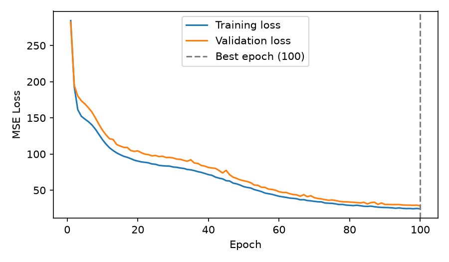

# Lakeshore Bike Demand

## Overview

This project uses a neural network built with PyTorch to predict how many bikes will be rented based on information such as the time of day, weather, and station type.

The goal is to see how well a neural network can predict bike rentals and compare its results with two simpler methods.

## How to run it

First, clone or download the GitHub repository and open the project folder in VS Code.

**Step 1: Create the Conda environment**

```bash
conda env create -f environment.yml
```

**Step 2: Activate the environment**

```bash
conda activate lab07-first-principles
```

**Step 3: Run the model**

```bash
python train.py
```

This runs the three experiments and saves the results in the `reports` folder.

**Step 4: Run the tests**

```bash
python -m pytest
```

All 24 automated tests passed.

**Step 5: Check the code**

```bash
python -m ruff check .
```

To check the formatting of the files I worked on:

```bash
python -m ruff format --check model.py prepare.py train.py tests
```

The provided `bikes_data.py` file was kept unchanged.

## Data and split

The dataset contains 6,000 rows of bike rental data.

I divided the data into three groups:

| Data       | Percentage |  Rows |
| ---------- | ---------: | ----: |
| Training   |        60% | 3,600 |
| Validation |        20% | 1,200 |
| Testing    |        20% | 1,200 |

The training data is used to teach the model. The validation data is used to compare results and choose the best model. The test data is used at the end to check how well the selected model performs.

I used a random seed of 42 so the data would be split the same way each time.

I fitted the data preprocessing steps using only the training data. I then used those same steps on the validation and test data.

This is important because the model should not learn information from the validation or test data before it is evaluated.

## Model and training

I created the neural network using PyTorch.

The network has two hidden layers with 16 neurons each. It uses ReLU activation functions to help learn more complicated patterns in the data.

The network has one output that predicts the number of bike rentals.

For training, I used:

- **Loss function:** Mean Squared Error (MSE), which measures prediction errors.
- **Optimizer:** which updates the model's weights to help it learn.
- **Batch size:** 64, meaning the model works with 64 rows at a time.
- **Epochs:** 100, meaning the model goes through the training data 100 times.
- **Random seed:** 42, to help make the results repeatable.

I shuffled the training data but not the validation or test data.

During training, I recorded the training loss, validation loss, and validation MAE.

I selected the best model using the lowest validation loss and restored its best weights before testing.

## Results

I compared the neural network to two simpler methods:

- **Training mean:** Predicts the average number of rentals from the training data.
- **Linear regression:** Uses a linear relationship between the input information and bike rentals.

The table shows the Mean Absolute Error (MAE) for each method. MAE tells us how many bike rentals the predictions were off by on average. A lower number is better.

| Model              | Validation MAE (rentals) | Test MAE (rentals) |
| ------------------ | -----------------------: | -----------------: |
| Training Mean      |                  10.1539 |             9.6491 |
| Linear Regression  |                   9.3169 |             8.5729 |
| **Neural Network** |               **3.6657** |         **3.5093** |

The neural network had the lowest error on both the validation and test data.

Its final test MSE was 27.2748.

This means the neural network was off by about 3.5 bike rentals on average when predicting the test data.

Linear regression performed a little better than using the training average, but it was not as accurate as the neural network. Bike rentals may follow patterns that are not straight lines, especially when factors such as time and weather affect demand together. This could explain why the neural network performed better.

### Learning curves



The learning curves show that both training and validation loss decreased over the 100 epochs. This means the model was improving its predictions. The two lines stayed fairly close together, and the lowest validation loss was at epoch 100.


## Experiments

I tested three different learning rates to see how they affected the neural network. The learning rate controls how much the model changes its weights when learning. I kept the other settings the same so I could compare the results fairly.

| Experiment   | Learning Rate | Best Epoch | Best Validation MAE | Final Training Loss | Final Validation Loss |
| ------------ | ------------: | ---------: | ------------------: | ------------------: | --------------------: |
| Original     |         0.001 |        100 |              6.6821 |             91.6002 |              104.3793 |
| Experiment 1 |         0.003 |        100 |              3.6657 |             24.3316 |               28.4822 |
| Experiment 2 |        0.0003 |        100 |              8.0796 |            128.3828 |              150.2750 |

**Original:** The model improved during training, but its validation error was higher than Experiment 1.

**Experiment 1:** Increasing the learning rate to 0.003 gave the best results. The model learned faster and had the lowest validation error.

**Experiment 2:** Lowering the learning rate to 0.0003 made the model learn more slowly. It had the highest validation error after 100 epochs.

I selected Experiment 1 because it had the lowest validation loss.

I only checked the test results after choosing the best experiment.

The results from all three experiments are saved in the `reports` folder.

## Limitations

This model was trained using the Lakeshore Bike Share dataset, so it represents the bike rental patterns in that dataset. It does not necessarily represent every bike-sharing system or every city.

The model can only make predictions using the information included in the data. It cannot see other factors that might affect rentals, such as special events, road closures, or unexpected changes in demand.

The model also cannot tell us exactly why someone chooses to rent a bike. It only learns patterns from the information it was given.

Although the neural network performed better than the two baseline methods, its predictions are not always correct.

Planners could use these predictions to help estimate bike rental demand, but they should not rely on the model alone to make important decisions about staffing, bike availability, or station planning.
